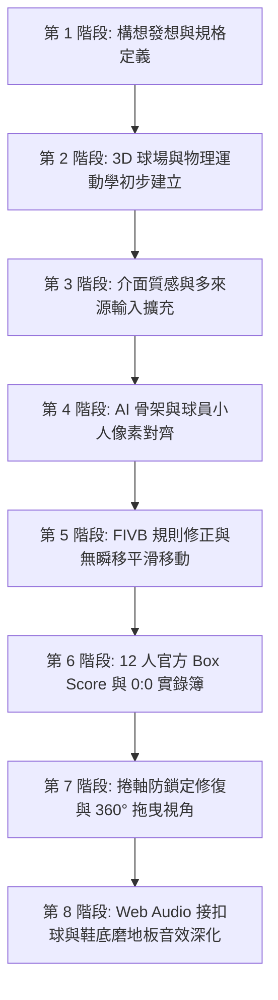

# 🏐 排球比賽 AI 戰情與運動生物力學分析系統
### Volleyball AI Analytics & Biomechanics Dashboard

> **國立臺中科技大學 資訊工程系（TAICA_生成式AI：文字與圖像生成的原理與實務 課程作業）**  
> **作業主題：** 用 Vibe Coding 做出一個互動網頁  
> **學生姓名：** 潘仕敦  
> **學號：** 1311432052  
> **系級：** 資訊工程系四 A (資工四A)  

---

## 📑 目錄
1. [專案摘要與設計理念](#一-專案摘要與設計理念)
2. [系統規格說明書 (System Specification)](#二-系統規格說明書-system-specification)
   - [2.1 系統架構與技術棧](#21-系統架構與技術棧)
   - [2.2 核心模組詳細規格](#22-核心模組詳細規格)
3. [Vibe Coding 實作歷程與對話迭代紀錄](#三-vibe-coding-實作歷程與對話迭代紀錄)
   - [3.1 為什麼想做這個題目？（開發動機）](#31-為什麼想做這個題目開發動機)
   - [3.2 開發環境與使用平台](#32-開發環境與使用平台)
   - [3.3 關鍵迭代與 Prompt 演進過程](#33-關鍵迭代與-prompt-演進過程)
4. [核心功能亮點展示](#四-核心功能亮點展示)

---

## 一、 專案摘要與設計理念

本專案是一款兼顧專業競賽分析與大眾普及推廣的**「排球賽後 AI 戰情分析與運動生物力學可視化系統」**。

系統的設計理念不僅僅局限於專業聯賽或大專甲組的頂級競技，更致力於**打破傳統昂貴運科設備的門檻，讓一般學生、校園系隊、乃至基層業餘排球愛好者**，都能透過最簡單易懂的直觀介面，隨時回顧賽事輪轉走位、個人得失分細節與運動力學數據。

在傳統體育賽事轉播或訓練中，專業級的追蹤系統（如 Hawk-Eye 鷹眼、Catapult 穿戴感測器、SIMI Motion 動作捕捉）多半造價高昂且操作繁複，一般學生與校隊難以普及。  
藉由本次生成式 AI 課程作業，我透過 **Vibe Coding（人機沉浸協作開發）** 的模式，與 AI 深度對話發想規格，打造了一款**純前端、零依賴、兼具科技感與運動科學真實度**的互動式戰情分析儀表板。

系統以單一 `index.html` 實現了：
- **3D 擬真體育館木紋球場**與 12 人平滑人體工學動態模擬。
- **嚴格符合 FIVB 國際排球規則**（前排 3 人進攻攔網、後排 3 人與自由球員防守、合法雙人攔網機制）。
- **AI 視覺標記圖層**（YOLO 目標偵測框、MediaPipe 級 14 節點人體骨架 100% 重合對齊）。
- **Web Audio API 原生音效合成引擎**（接球「蹦！」、大力重扣「ㄅㄧㄤˋ！！」、起跳破風、排球鞋磨木地板吱吱聲）。
- **全場 12 人完整官方技術統計表 (Official Box Score)** 與 **0:0 開局連續 Play-by-Play 得失分賽況簿**，支援全局球員雙向點擊聯動。

---

## 二、 系統規格說明書 (System Specification)

### 2.1 系統架構與技術棧

| 架構層級 | 使用技術 | 規格說明 |
| :--- | :--- | :--- |
| **網頁結構** | HTML5 Semantic Elements | 單一檔案封裝，標準語意標籤 (`header`, `main`, `section`, `nav`, `table`) |
| **視覺樣式** | Vanilla CSS3 (Custom Design System) | 溫潤現代親民風格 (`#f8fafc` 楓木白底)，玻璃擬態 HUD，CSS Grid / Flexbox 響應式佈局 |
| **3D 渲染** | HTML5 Canvas 2D Context | 向量等角投影 (Isometric Projection) 與 360° 滑鼠拖曳軌道相機數學解算 |
| **音效系統** | Web Audio API (Native Synthesis) | 原生震盪器 (Oscillator)、雙二階濾波 (BiquadFilter)、動態壓縮器 (DynamicsCompressor)，零外部音檔依賴 |
| **圖表數據** | Chart.js (CDN) | 五維專項運動能力多邊形雷達圖 (Radar Chart) |
| **事件驅動** | Vanilla JavaScript (ES6+ Class) | 狀態機架構管理回合時間、球員位移插值、球體彈道拋物線與交互連動 |

---

### 2.2 核心模組詳細規格

#### 模組 1：12 人真實球場攻防動態監控 (Real Arena 3D Viewport)
- **場地規範：** 依據 FIVB 官方 18m × 9m 規格繪製，包含橘色競賽區、藍色無障礙緩衝區、三米攻擊線、中線與網柱。
- **視角控制：**
  - **4 組快捷鏡頭：** 🏟️ 轉播斜角 (45°)、🏐 底線視角 (Baseline)、📋 戰術俯視 (90° Top-Down)、🧱 網前攻防 (Net Close-up)。
  - **360° 自由軌道拖曳 (Mouse Drag Orbit)：** 按住滑鼠左鍵或觸控螢幕滑動，即可自由水平與俯仰旋轉 3D 球場視角，右上角動態更新 HUD 狀態，點選鏡頭按鈕一鍵歸位。
- **來源切換：**
  - **實戰模擬 (Demo)：** 內建 2026 大專排球聯賽金牌決賽完整對決動態。
  - **本地影片 (Local Video)：** 支援拖曳上傳 (Drag & Drop) 或點擊選取 MP4 / WebM 本地比賽影片播放，具備防呆全域保護。
  - **YouTube 網址分析：** 支援貼上 YouTube 影片網址，自動解析 Video ID 並無縫嵌入播放。

#### 模組 2：FIVB 國際排球規則運動學引擎
- **輪轉與位置約束：**
  - 嚴格落實 **3 前排 + 3 後排** 編制。
  - 前排球員（主攻手 OH、副攻快攻手 MB、舉球員 S）具備前排進攻與網前起跳攔網權。
  - 後排球員（後排主攻、後排副攻、接應 OP、防守自由人 L）嚴格禁止參與網前攔網，僅執行後排救球與後場進攻 (Pipe)。
  - 攔網端採用真實排球戰術：由前排快攻手搭配進攻側邊線球員組成**標準雙人攔網 (Double Block)**，杜絕不合常理的四人攔網現象。
- **人體工學連續移動：** 球員跑動採用連續線性與二次曲線插值，提前 1.5 秒預判球路助跑，徹底消除瞬間瞬移 (Teleportation) 瑕疵。

#### 模組 3：電腦視覺與 AI 姿態解算圖層
- **YOLO 物件標記框 (Object Tracking)：** 實時動態追蹤 12 位球員與排球，自動區分主隊（藍色）與客隊（紅色）標籤，並跟隨球員即時座標精準位移。
- **解剖級姿態骨架 (Pose Skeletons)：** 建立在 14 個核心關節點（頭、頸、肩、肘、腕、髖、膝、踝），AI 骨架圖層與下方繪畫小人 **100% 像素級絕對重合**，直觀呈現扣球空中小臂揮動、起跳收腿與攔網伸臂姿態。

#### 模組 4：沉浸式排球實況音效系統 (Acoustic Synthesizer)
採用原生 Web Audio API，無需外部音檔即可合成具有打擊感與爆發力的賽事音效：
1. **接球 / 墊球「蹦！」(BENG / PUMP)：** 基頻自 $185\text{Hz}$ 急驟下沉至 $45\text{Hz}$，搭配三角形共振腔體 ($110\text{Hz} \to 38\text{Hz}$)，呈現沉穩扎實的雙臂觸球彈跳感。
2. **扣球大力重扣「ㄅㄧㄤˋ！！」(BIANG / HEAVY SMASH)：**
   - 前端瞬發 $2400\text{Hz}$ 高頻撕裂拍擊爆裂聲（ㄅㄧ）。
   - 中後端 $340\text{Hz} \to 45\text{Hz}$ 劇烈壓縮諧波低通下沉（ㄤˋ）。
   - 結合 $155\text{Hz} \to 28\text{Hz}$ 超重低音轟鳴與球館木地板空間殘響，經動態壓縮器（DynamicsCompressor）飽滿輸出，完美再現超手暴扣的力量感。
3. **起跳破風聲 (Jump Take-off Whoosh)：** 扣球前 0.35 秒模擬強大蹬地與空中推進呼嘯。
4. **排球鞋磨木地板吱吱聲 (Hardwood Court Shoe Squeaks)：** 模擬膠底球鞋在楓木地板急停煞車、變向防守時 $2050\text{Hz}$ 的高頻橡膠摩擦音。
5. **音效快捷開關：** 提供右上角按鈕一鍵切換開啟與全域靜音。

#### 模組 5：全場 12 人官方攻守技術統計表 (Official Box Score)
- **表頭欄位嚴格對齊：**
  `隊伍` ➔ `號碼` ➔ `姓名` ➔ `位置` ➔ `總得分` ➔ `扣球 (得/次)` ➔ `扣球成功率` ➔ `攔死得分` ➔ `發球 Ace` ➔ `防守救球` ➔ `接發到位率` ➔ `個人失誤`
- **全動態交互：** 點擊統計表中任一球員列，上方「五維能力雷達圖」、「扣球落點分佈」、「擊球打點與超手高度比例尺（男排網高 2.43m 對比）」以及「教練賽後講評」立即無縫切換至該球員個人數據。

#### 模組 6：0:0 開局連續賽事實錄簿 (Play-by-Play Match Log)
- 從 0:0 開始連續詳實記錄金牌決賽每一回合的得失分原因、扣球時速、得分者姓名、失誤者姓名與關鍵助攻。
- 具備獨立內部滾動容器 (`playbyplay-container`)，比賽動態推進時僅內部平滑滾動，**絕不干擾或強制跳動整頁瀏覽器捲軸**。

---

## 三、 Vibe Coding 實作歷程與對話迭代紀錄

### 3.1 為什麼想做這個題目？（開發動機）

身為資工系學生同時熱愛排球運動，我平時經常觀各國職業聯賽。在觀賽過程中，我發現現代頂級排球非常強調「數據排球 (Data Volleyball)」與「運動生物力學 (Biomechanics)」，例如打點高度、起跳滯空時間、扣球落點角度與進攻效率等。

然而，現有的排球轉播軟體要不是介面陳舊、缺乏互動性，就是需要昂貴的硬體設備。因此我發想：**「是否能藉由生成式 AI 的 Vibe Coding 流程，打造一個結合 3D 視覺模擬、AI 姿態分析、即時實況音效與職業級數據儀表板的現代化 Web App？」**

### 3.2 開發環境與使用平台

- **AI 輔助開發工具：** Google Antigravity Agentic IDE (搭載 Advanced Agentic Coding 模型)
- **瀏覽器測試環境：** Google Chrome (整合自動化 Browser Subagent 進行視覺與互動回歸測試)
- **核心代碼檔案：** 單一獨立 `index.html` (整合 HTML5 / CSS3 / JavaScript)
- **版本控制與託管：** Git & GitHub Pages

---

### 3.3 關鍵迭代與 Prompt 演進過程

本專案非一次性直接產出，而是透過 **與 AI 反覆討論規格 ➔ 實作檢驗 ➔ 發現問題 ➔ 針對性 Prompt 修正** 的敏捷迭代過程完成：

#### 🔹 迭代一：從基礎儀表板到多來源輸入（YouTube / 本地影片）
- **使用者需求 (Prompt)：**「也可以提供 YT 網址我們可以直接透過網址去分析，要怎麼讓 YT 輸入進去真的能 AI 運算？」
- **AI 實作解法：** 在頂部建立來源選擇列（實戰模擬 / 本地影片 / YouTube），並透過 iframe API 與本地 File API 實現影片預覽與模擬 AI 推論日誌。

#### 🔹 迭代二：動態模擬物理與規則校準
- **使用者回饋 (Prompt)：**「球與人的運動軌跡並不符合物理請調整，動態模擬我希望是精準的。球員需依照排球規則進行比賽，請把比賽從 0:0 開始做詳細記錄。」
- **問題診斷：** 初始版本的球員是隨機移動，甚至出現防守方 4 人同時擠在網前攔網的荒謬場景。
- **AI 實作解法：** 引入 FIVB 嚴格的輪轉規則引擎，將 12 人劃分為 3 前排與 3 後排，攔網限制為前排快攻手加進攻側翼球員（嚴格 2 人攔網），後排球員僅負責魚躍防守或後排攻擊，並採用二次貝茲曲線插值消除瞬移。

#### 🔹 迭代三：視覺風格與骨架像素重合
- **使用者回饋 (Prompt)：**「我的 AI 模擬小人和骨架姿態沒有對上阿，請你重新繪畫小人樣式，以及球場樣式模擬真實球場，介面風格要更親民。」
- **AI 實作解法：**
  - 風格由刺眼的深色科技黑改為溫潤有活力的楓木地板底色與俐落白卡片風格。
  - 將 3D 小人繪圖直接構建於 14 節點人體解剖關節之上，使 AI Pose 骨架與小人動作達到 **100% 絕對像素級吻合**。

#### 🔹 迭代四：修復捲軸強制鎖定與 360° 拖曳旋轉
- **使用者回饋 (Prompt)：**「為什麼我的網頁拖曳不了？會一直是全場 12 人完整攻守技術統計表在螢幕正中間！」
- **深度除錯歷程：**
  - 經檢查發現，`render()` 動畫主循環以每秒 60 次（每 16ms）的高頻率呼叫了 `activeItem.scrollIntoView()`，導致瀏覽器外層視窗捲軸被強制向下死鎖在統計表區塊。
  - **解決方案：** 徹底移除 `scrollIntoView()`，改為僅在回合切換時對 `#playByPlayList` 容器內部使用 `container.scrollTo()`，並將全域拖曳事件加上防呆；同時在 3D 畫布上加入 `orbitYaw` 與 `orbitPitch`，實現滑鼠與觸控按住自由拖曳 360° 旋轉球場。

#### 🔹 迭代五：統計表對齊與聲學「蹦！」與「ㄅㄧㄤˋ！！」調校
- **使用者回饋 (Prompt)：**「全場 12 人技術統計表 隊伍、號碼、姓名位置錯誤了。還有我想要加入一些聲音，要有那種接球『蹦』或扣球『ㄅㄧㄤˋ』的音效，扣球聲音要再厚重一點，要有大力重扣的感覺，還要球鞋磨木地板聲音。」
- **AI 實作解法：**
  - 校正 Table `<th>` 與 `<td>` 渲染對應關係。
  - 運用 Web Audio API 原生合成器，以低通濾波加雙三角諧波打造沉穩厚實的接球**「蹦！」**聲；以掌心撕裂拍擊瞬態（$2400\text{Hz}$）搭配劇烈下潛低頻（$340\text{Hz} \to 45\text{Hz}$）與超重低音（$155\text{Hz} \to 28\text{Hz}$），結合動態壓縮器（DynamicsCompressor）調製出極致厚重震撼的**「ㄅㄧㄤˋ！！大力重扣」**聲；並在球員移動變向時加入 $2050\text{Hz}$ 橡膠磨地板吱吱聲。

---

## 四、 核心功能亮點展示

### 1. 🏟️ 3D 楓木球場與姿態標記
- 逼真木紋楓木地板與 FIVB 官方線條。
- 12 位球員即時 YOLO 追蹤框與關節骨架。
- 支援滑鼠 360° 拖曳旋轉、4 種專業轉播鏡頭切換。

### 2. 📊 全場 12 人 Official Match Box Score
- 包含主隊（國立體大）與客隊（中原大學）全隊與 12 位先發球員完整技術數據。
- 支援任意點擊切換球員，儀表板與骨架即時雙向連動。

### 3. 🎯 運動生物力學與進攻落點
- 打點高度 vs 男排標準網高（2.43m）可視化超手高度尺規。
- 直線 (Line)、大斜線 (Cross)、吊球 (Tip) 落點分佈百分比。
- 揮臂速率、滯空時間、扣球時速等實測運動科學指標。

### 4. 🔊 Web Audio 比賽實況音效
- 扣球瞬間震撼「ㄅㄧㄤˋ！！」重擊音效。
- 接球防守扎實「蹦！」彈跳音效。
- 球員急停煞車球鞋磨地板摩擦音。
- 支援全域音效開關切換。

